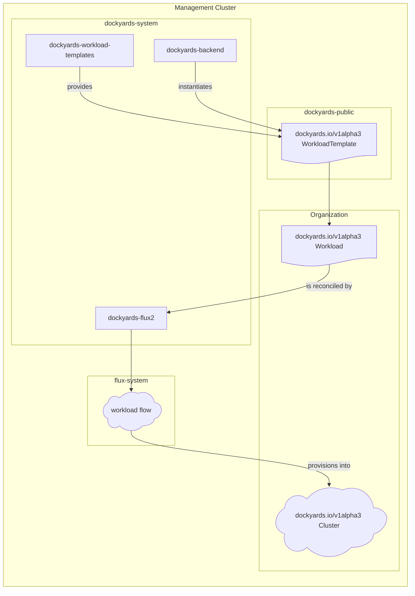

# Dockyards Workload Templates

`dockyards-workload-templates` bundles the shared CUE templates that define the catalog of deployable workloads, the generator that turns those templates into `WorkloadTemplate` CRDs, and the curated manifests you apply into the management cluster (usually `dockyards-public`). This component is primarily a content pipeline: maintainers edit reusable CUE packages, run `generate-workloadtemplate-manifests`, and publish the resulting CRDs. The component diagram below shows how the generator, backend, and Flux stack stitch together to get workloads into target clusters.

## Component diagram


The flowchart tracks the key CRDs and services involved: template authors maintain the CUE source inside this repo, the generator produces checked-in `WorkloadTemplate` manifests, `dockyards-backend` instantiates `Workload` CRs that reference them, and `dockyards-flux2` turns the workload into Flux Helm/Kustomize sources (`WorkloadFlow`) that eventually provision into the workload cluster.

## Workflow

- Edit or add a package under `templates/` that defines the required `#cluster` and `#workload` helpers plus any component-specific input hooks (e.g., Helm releases, secrets, Ingress routes).
- Run `go run ./cmd/generate-workloadtemplate-manifests --root templates --outpath manifests` to regenerate the `manifests/workloadtemplate_*.yaml` files from the CUE source.
- Commit and apply the manifests (or `kustomize build manifests`) to the `dockyards-public` namespace so the `dockyards.io/v1alpha3 WorkloadTemplate` objects are visible to the backend.
- When an operator creates a `Workload` that references one of these templates, `dockyards-backend` instantiates the CR and `dockyards-flux2` reconciles it into the Flux primitives shown as `WorkloadFlow`, which ultimately provision workloads into the `dockyards.io/v1alpha3 Cluster` target.

## Generation details

- Source templates live under `templates/<component>/<component>.cue` and are parsed via the CUE toolchain embedded in `cmd/generate-workloadtemplate-manifests`.
- The generator sanitizes the template names, emits each manifest as `workloadtemplate_<name>.yaml`, and writes `manifests/kustomization.yaml` so installers can apply the entire catalog with a single `kustomize build`.
- Keep the `manifests/` directory checked in so operators can deploy the exact `WorkloadTemplate` catalog that matches the CUE source. Re-running the generator before pushing keeps the checked-in YAML and CUE in sync and prevents drift between the API-facing objects and their construction logic.

## ExternalDNS (RFC 2136)

The `external-dns-rfc2136` template installs the upstream ExternalDNS Helm chart
with the RFC 2136 provider only. It is separate from the existing generic
`external-dns` template and does not change that template's contract.

### Staged reconciliation

The template emits a Worktree and two management-cluster Flux Kustomizations:

```text
<workload>-prerequisites              <workload>
00-prerequisites              ──────> 10-external-dns
namespace + Gateway API checks       HelmRepository + HelmRelease
                              dependsOn
```

- **Prerequisites** applies the namespace using `<cluster>-kubeconfig` and checks
  its readiness. When using `gateway-httproute`, it also checks that the Gateway
  and HTTPRoute CRDs exist and are established in the target cluster, including
  when another workload manages them.
- **ExternalDNS** explicitly depends on prerequisites and waits for the Helm
  resources to become ready. The HelmRepository and HelmRelease live in the
  Workload's management namespace; the HelmRelease uses `<cluster>-kubeconfig`
  to install ExternalDNS into `spec.targetNamespace`. No Flux controllers are
  required in the target cluster.

Directory numbers are descriptive; `spec.dependsOn` enforces the ordering.
Both stages read different paths from the Worktree's GitRepository.

Gateway API CRDs are **not installed by default**, to avoid competing with
Traefik or another CRD owner. Set `gatewayAPICRD.install: true` to include the
upstream CRDs in prerequisites (defaults: `v1.5.0`, `experimental`). These CRDs
use `IfNotPresent` apply semantics and are retained on deletion; their subsequent
upgrades must be managed separately. Use `sources: [service]` for clusters that
do not use Gateway API.

### Input

Set the Workload's `spec.targetNamespace` to `external-dns`, for example, and
supply this `spec.input`:

```yaml
version: 1.23.0
sources:
  - service
  - gateway-httproute
domainFilters:
  - mgmt.example.com
rfc2136:
  hosts:
    - 192.0.2.29
    - 192.0.2.30
  zones:
    - mgmt.example.com
  tsigKeyName: mgmt-update
  tsigSecretAlgorithm: hmac-sha256
  tsigSecretRef:
    name: external-dns-rfc2136
    key: tsig-secret
```

Only `domainFilters`, `sources`, and the RFC 2136 `hosts`, `zones`, and
`tsigKeyName` are required. The other fields shown use their defaults.
Optional settings also include `repository`, `namespaceLabels`, `txtPrefix`
(default `external-dns-`), `policy` (default `sync`), and `rfc2136.port`
(default `53`). Supported sources are `service`, `gateway-httproute`,
`gateway-tcproute`, and `gateway-tlsroute`; at least one source, host, zone, and
domain filter is required.
There is deliberately no generic provider selector or arbitrary Helm values input.

Provision the referenced Secret **in the organization's management-cluster
namespace**, alongside the Workload and HelmRelease. No pre-existing credential
Secret is required in the target cluster. `rfc2136.tsigSecretRef.name` and `key`
select this management-side Secret and its data key; cross-namespace references
are not supported.

The HelmRelease uses `spec.valuesFrom` with `targetPath: env[0].value` to resolve
the credential at reconciliation time. The Workload input, Worktree files, and
generated Git contain only the reference and an empty environment-value
placeholder, never the credential itself. Missing Secrets or keys cause
reconciliation to fail rather than silently install without credentials.

Store the DNS administrator's base64 TSIG value as-is in the selected Secret
entry (for example, using `stringData` or `kubectl --from-file`); do not decode
the TSIG value or base64-encode it again before supplying it through those
interfaces. Kubernetes' `data` field still requires its normal outer base64
encoding.

Label the management Secret `reconcile.fluxcd.io/watch: Enabled` so Flux promptly
reconciles the HelmRelease when the credential changes. The changed environment
value triggers a Deployment rollout, so rotation requires no manual pod restart.
Without the watch label, the change is picked up on periodic reconciliation.

**Security:** the resolved credential becomes a literal environment value in the
target Deployment and is included in Helm's stored release data. Restrict access
to those resources as well as to the management Secret. The template accepts no
inline TSIG secret and does not create or copy credential Secrets.

Endpoints are ordered failover servers for the same zones and TSIG identity,
not independent providers. AXFR is enabled and load balancing is disabled.
Allow authenticated zone transfers and updates, including ownership TXT records,
and ensure the target cluster can reach the DNS servers.

`txtOwnerId` is not configurable: it is derived as `<organization-name>/<cluster-name>`
from the Cluster's `dockyards.io/organization-name` label and `metadata.name`.
The organization name is not assumed to equal the management namespace. The `/`
separator makes the pair unambiguous because Kubernetes names cannot contain it.
Changing either name changes DNS ownership; existing records using a previous
owner ID require an ownership migration.

The default `sync` policy allows deletion of owned records when Kubernetes
resources disappear. Validate ownership, zone transfers, and domain scope before
deployment. Set `policy: upsert-only` to prevent record deletion and leave stale
records behind instead.

### Validation

Run `go test ./...` to test both the CUE source and generated template, including
input validation, stage dependencies, remote-cluster targeting, and offline
Kustomize builds of the generated stage directories.
